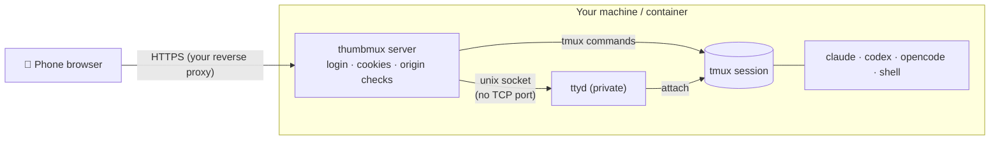

<p align="center">
  
</p>

<h1 align="center">thumbmux</h1>
<p align="center"><b>Your tmux sessions and AI coding agents, one thumb away.</b><br>
A password-protected, mobile-first web terminal for tmux: tabs, swipe scrolling, a real input box, file & photo upload, optional voice input.</p>

<p align="center">
  
  <a href="https://github.com/meshoklv/thumbmux/actions/workflows/ci.yml"></a>
  
  
  
  
</p>

<p align="center">
  <a href="#quick-start">Quick start</a> ·
  <a href="#features">Features</a> ·
  <a href="#how-it-works">How it works</a> ·
  <a href="#security">Security</a> ·
  <a href="README.ru.md">Русский</a>
</p>

---

## Why

Claude Code, Codex, OpenCode and friends run for minutes or hours in a terminal. Checking on them from a phone through a plain web terminal is miserable: the keyboard fights the TUI, autocorrect eats your prompts, scrolling is impossible, and every session looks the same.

thumbmux puts a mobile UI in front of **your own tmux server**: a tab per session with live status, a normal text box that pastes into the pane (swipe typing and autocorrect just work), one-tap special keys, swipe-to-scroll, and uploads that land in the project folder. Your sessions keep running on the machine whether or not the phone is connected.

<table>
<tr>
<td width="33%"><b>📑 Tabs & session list</b><br>Telegram-style list with the last lines of each session and a live <i>working / waiting / done</i> dot.</td>
<td width="33%"><b>⌨️ Input that behaves</b><br>Type in a real text field; it is pasted into the pane. Esc, Tab, arrows, Ctrl-C and your own quick commands are one tap away.</td>
<td width="33%"><b>👆 Swipe scroll</b><br>Finger swipes become tmux scrollback; no more two-finger gymnastics.</td>
</tr>
<tr>
<td><b>📎 Photos & files</b><br>Attach a photo or any file; the path is typed into the agent's prompt.</td>
<td><b>🎙 Voice (optional)</b><br>Dictate through any OpenAI-compatible speech-to-text endpoint, local or cloud. Off by default.</td>
<td><b>🗂 File manager</b><br>Browse, rename, move, delete-to-trash and undo, right from the phone.</td>
</tr>
</table>

## Features

- **Tabs** — new tab with a shell or an agent (`claude`, `codex`, `opencode`, `gemini`, `aider`, or any command you list), rename, reorder, close.
- **Session list** — previews, working/waiting/done indicators, folders to group sessions.
- **Split panes** — split the active window and switch between panes.
- **Open a folder as a tab** — folder picker with favourites; launch an agent straight into it.
- **Resume Claude Code chats** — browse past transcripts and reopen them with `claude --resume`.
- **Uploads** — photos (JPEG/PNG, ≤15 MB) with thumbnail preview, any file ≤100 MB into the pane's working directory.
- **File manager** — browse, download, mkdir, rename, move, delete to trash, undo (last 50 operations).
- **Voice input** — record in the browser, transcribe via your configured endpoint, insert into the box.
- **Deep link** — `/m/?go=claude&cwd=/path` opens an agent tab in a folder (handy for a keyboard shortcut).
- **Self-updating page** — the open page reloads itself after you update the server.
- **Secure by default** — loopback bind, mandatory password, signed cookies, same-origin checks, the terminal reachable only through the login. See [Security](#security).

## Quick start

**Docker** (one command; the port is published on your machine's loopback only):

```bash
git clone https://github.com/meshoklv/thumbmux && cd thumbmux
docker compose up --build        # a random password is printed once in the logs
# open http://127.0.0.1:7682
```

**Without Docker** — needs `python3` (3.9+), `tmux`, `ttyd`:

```bash
sudo apt install tmux ttyd       # or: brew install tmux ttyd
cp .env.example .env             # optionally set THUMBMUX_PASSWORD
./run.sh
```

To reach it from your phone, put a TLS reverse proxy in front ([Caddy / nginx examples](deploy/)) or use an overlay network such as Tailscale. **Do not** publish the plain-HTTP port to the internet.

> [!NOTE]
> Tested on: Ubuntu 24.04, Python 3.12, tmux 3.4, ttyd 1.7.4 (login, session cookies, CSRF/origin checks, WebSocket tunnel and tmux control are covered by `tests/`). Not yet tested: the Docker image and the VPN compose file (no Docker on the build machine); the web UI was not re-checked in a browser after the open-source cleanup. The UI was designed for iOS Safari; desktop browsers work.

<details>
<summary><b>Install AI agents into the Docker image</b></summary>

The image contains tmux, ttyd and git only. To bake in agent CLIs:

```bash
docker compose build --build-arg INSTALL_AGENTS=1
docker compose up
```
Then run the agent's own login flow inside a tab (credentials live in the `thumbmux-home` volume).
</details>

## How it works



A single stdlib-only Python server renders the mobile page and a small JSON API that drives tmux (windows, keys, uploads, files). The live terminal is [ttyd](https://github.com/tsl0922/ttyd) attached to the same tmux session — but thumbmux starts it on a **private unix socket** and proxies it (HTTP + WebSocket) behind the login, so there is never an unauthenticated terminal listening anywhere. Because the sessions are plain tmux, you can attach from SSH at the same time.

## Configuration

All configuration is via environment variables (`.env.example` lists them).

| Variable | Default | Meaning |
|---|---|---|
| `THUMBMUX_PASSWORD` | *(random, printed once)* | Login password, ≥ 8 chars; weak/placeholder values are refused. Also `THUMBMUX_PASSWORD_FILE`. |
| `THUMBMUX_HOST` / `THUMBMUX_PORT` | `127.0.0.1` / `7682` | Bind address. Keep loopback unless a proxy/tunnel does the exposing. |
| `THUMBMUX_TRUST_PROXY` | `0` | Trust `X-Forwarded-*` from your reverse proxy (enables `Secure` cookie over HTTPS). |
| `THUMBMUX_ALLOWED_ORIGINS` | – | Extra allowed origins for POST/WebSocket (comma separated). |
| `THUMBMUX_SESSION` | `phone` | tmux session name. |
| `THUMBMUX_WORKDIR` | `$HOME` | Start directory for new tabs. |
| `THUMBMUX_AGENTS` | `claude,codex,opencode,gemini,aider` | Commands offered in the "new tab" menu. |
| `THUMBMUX_DATA_DIR` | `~/.thumbmux` | Settings, favourites, password hash, session key (mode 600). |
| `THUMBMUX_TMUX_SOCKET` | – | Explicit tmux socket (`tmux -S`): all tmux calls go to that server only, never to your normal one. |
| `THUMBMUX_TMUX_CONF` | `~/.tmux.conf` | tmux config applied at start (`deploy/tmux.conf` recommended). |
| `THUMBMUX_STT_URL` | – | OpenAI-compatible transcription endpoint. **Empty = voice input is off.** |
| `THUMBMUX_STT_KEY` / `_MODEL` / `_LANGUAGE` | – / `whisper-1` / – | Credentials and model for the endpoint. |

## Security

thumbmux gives whoever logs in **a shell on the machine it runs on**. Treat it like SSH.

- **Loopback by default.** Without `THUMBMUX_HOST` it only listens on `127.0.0.1`. Docker publishes the port on the host's loopback only.
- **Mandatory authentication.** There is no default password. If you set none, a random one is generated, saved to `~/.thumbmux/password` (mode 600) and printed once. Weak or placeholder passwords stop the server from starting.
- **Everything is behind the login** except `/login` and `/healthz`. The terminal (ttyd) listens on a private unix socket and is only reachable through the authenticated proxy; the login password is not exported into the terminal's environment.
- **Sessions:** signed (HMAC-SHA256), expiring, `HttpOnly`, `SameSite=Strict` cookies, `Secure` over HTTPS. Failed logins are throttled per client address (5 tries, then a 1-minute lock).
- **CSRF / cross-site WebSocket hijacking:** every POST and every WebSocket upgrade must carry a same-origin `Origin`/`Referer` (and a non-cross-site `Sec-Fetch-Site`); otherwise 403.
- **Put it behind TLS.** Run a reverse proxy with HTTPS (see [`deploy/Caddyfile.example`](deploy/Caddyfile.example), [`deploy/nginx.example.conf`](deploy/nginx.example.conf)), forward the `Host` header, and set `THUMBMUX_TRUST_PROXY=1`. Or keep it on loopback and reach it through an SSH tunnel / Tailscale. Serve it on its own (sub)domain, not under a path prefix.
- **Optional hardening:** run it in a container (`docker compose`), and/or inside a VPN kill-switch ([`docker-compose.vpn.yml`](docker-compose.vpn.yml)) so a dropped tunnel leaves the container with no network at all.
- **Voice input** sends audio only to the endpoint *you* configure.

> [!WARNING]
> A single shared password protects a shell. Use a long unique one, keep it behind HTTPS, and don't expose the port directly. Report vulnerabilities privately via GitHub Security Advisories.

## FAQ

**Does it replace SSH?** No — it is a phone-friendly front for tmux. Sessions are normal tmux, so `ssh` + `tmux attach -t phone` shows the same windows.

**Can I use it with plain tmux sessions without agents?** Yes; agents are just commands typed into a new window. Set `THUMBMUX_AGENTS=` to show only "Terminal".

**Which tmux server does it use?** The default one of the user running it (or the one given by `THUMBMUX_TMUX_SOCKET`). It never inherits a nested `$TMUX`.

## Contributing

Issues and PRs are welcome. Run `python3 -m unittest discover -s tests -v` (needs `tmux` and `ttyd`) before sending a change.

## License

[MIT](LICENSE)

Made by [@meshoklv](https://github.com/meshoklv)
