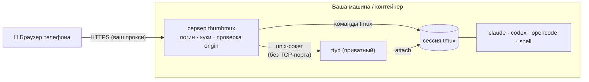

<p align="center">
  
</p>

<h1 align="center">thumbmux</h1>
<p align="center"><b>Ваши tmux-сессии и ИИ-агенты — под большим пальцем.</b><br>
Мобильный веб-терминал для tmux под паролем: вкладки, скролл свайпом, нормальное поле ввода, загрузка фото и файлов, голосовой ввод по желанию.</p>

<p align="center">
  
  <a href="https://github.com/meshoklv/thumbmux/actions/workflows/ci.yml"></a>
  
  
  
  
</p>

<p align="center">
  <a href="#быстрый-старт">Быстрый старт</a> ·
  <a href="#возможности">Возможности</a> ·
  <a href="#как-это-устроено">Как устроено</a> ·
  <a href="#интеграция-с-telegram">Telegram</a> ·
  <a href="#безопасность">Безопасность</a> ·
  <a href="README.md">English</a>
</p>

---

## Зачем

Claude Code, Codex, OpenCode и им подобные работают в терминале минуты и часы. Заглянуть в них с телефона через обычный веб-терминал мучительно: клавиатура воюет с TUI, автозамена съедает промпты, скролла нет, а все сессии выглядят одинаково.

thumbmux ставит мобильный интерфейс перед **вашим собственным tmux**: вкладка на сессию с живым статусом, обычное текстовое поле, которое вставляет текст в панель (свайп-набор и автозамена работают), спецклавиши в одно касание, скролл свайпом и загрузка файлов прямо в папку проекта. Сессии продолжают работать на машине, подключён телефон или нет.

<table>
<tr>
<td width="33%"><b>📑 Вкладки и список сессий</b><br>Список в духе Telegram: последние строки каждой сессии и индикатор <i>работает / ждёт / готово</i>.</td>
<td width="33%"><b>⌨️ Ввод, который слушается</b><br>Печатаете в обычном поле — текст вставляется в панель. Esc, Tab, стрелки, Ctrl-C и свои быстрые команды — одним тапом.</td>
<td width="33%"><b>👆 Скролл свайпом</b><br>Движение пальца листает историю tmux — без акробатики двумя пальцами.</td>
</tr>
<tr>
<td><b>📎 Фото и файлы</b><br>Прикрепите фото или любой файл — путь подставится в запрос агента.</td>
<td><b>🎙 Голос (по желанию)</b><br>Диктовка через любой OpenAI-совместимый сервис распознавания — локальный или облачный. По умолчанию выключено.</td>
<td><b>🗂 Файловый менеджер</b><br>Просмотр, переименование, перенос, удаление в корзину и отмена — с телефона.</td>
</tr>
</table>

## Возможности

- **Вкладки** — новая вкладка с шеллом или агентом (`claude`, `codex`, `opencode`, `gemini`, `aider` или любая команда из вашего списка), переименование, перестановка, закрытие.
- **Список сессий** — превью, индикаторы работы, папки для группировки.
- **Разделение панелей** — разбить окно и переключаться между частями.
- **Папка как вкладка** — выбор папки с избранным, агент сразу запускается в ней.
- **Возврат в чаты Claude Code** — просмотр прошлых транскриптов и открытие через `claude --resume`.
- **Загрузки** — фото (JPEG/PNG, до 15 МБ) с миниатюрой, любые файлы до 100 МБ в рабочую папку панели.
- **Файловый менеджер** — обзор, скачивание, создание папок, переименование, перенос, корзина, отмена (последние 50 операций).
- **Голосовой ввод** — запись в браузере, распознавание через ваш сервис, вставка в поле.
- **Telegram-бот (по желанию)** — пишет, когда вкладка закончила работу или задала вопрос; отвечайте из чата текстом или голосом. См. [Интеграция с Telegram](#интеграция-с-telegram).
- **Deep link** — `/m/?go=claude&cwd=/path` открывает вкладку с агентом в папке (удобно для горячей клавиши).
- **Самообновление страницы** — открытая страница перезагружается сама после обновления сервера.
- **Безопасно по умолчанию** — только loopback, обязательный пароль, подписанные куки, проверка origin, терминал доступен только через логин. См. [Безопасность](#безопасность).

## Быстрый старт

**Docker** (одна команда; порт публикуется только на loopback хоста):

```bash
git clone https://github.com/meshoklv/thumbmux && cd thumbmux
docker compose up --build        # случайный пароль напечатается один раз в логах
# откройте http://127.0.0.1:7682
```

**Без Docker** — нужны `python3` (3.9+), `tmux`, `ttyd`:

```bash
sudo apt install tmux ttyd       # или: brew install tmux ttyd
cp .env.example .env             # при желании задайте THUMBMUX_PASSWORD
./run.sh
```

Чтобы открыть с телефона, поставьте перед ним TLS-прокси ([примеры Caddy / nginx](deploy/)) или используйте оверлейную сеть вроде Tailscale. **Не** публикуйте порт с обычным HTTP в интернет.

> [!NOTE]
> Проверено: Ubuntu 24.04, Python 3.12, tmux 3.4, ttyd 1.7.4 (вход, сессионные куки, проверки CSRF/origin, WebSocket-туннель и управление tmux покрыты тестами в `tests/`). Не проверено: Docker-образ и VPN-compose (на машине сборки нет Docker); веб-интерфейс не перепроверялся в браузере после подготовки к публикации. Интерфейс делался под iOS Safari; в десктопных браузерах работает.

<details>
<summary><b>Установить ИИ-агентов в Docker-образ</b></summary>

В образе только tmux, ttyd и git. Чтобы добавить CLI агентов:

```bash
docker compose build --build-arg INSTALL_AGENTS=1
docker compose up
```
Затем пройдите вход агента во вкладке (учётные данные лежат в томе `thumbmux-home`).
</details>

## Как это устроено



Один сервер на чистом Python (только стандартная библиотека) отдаёт мобильную страницу и небольшой JSON API, управляющий tmux (окна, клавиши, загрузки, файлы). Живой терминал — [ttyd](https://github.com/tsl0922/ttyd), подключённый к той же сессии, но thumbmux запускает его на **приватном unix-сокете** и проксирует (HTTP + WebSocket) за логином: нигде не слушает терминал без аутентификации. Сессии — обычный tmux, поэтому параллельно можно подключаться по SSH.

## Интеграция с Telegram

Необязательная и **выключена по умолчанию**. Встроенный бот присылает уведомление, когда вкладка закончила работу или задала вопрос, и позволяет ответить прямо из чата. Отдельный сервис не нужен: бот работает внутри сервера и ходит в Telegram только исходящим HTTPS (long-polling, без вебхука и открытых портов).

**1. Создайте бота.** Откройте [@BotFather](https://t.me/BotFather), отправьте `/newbot`, скопируйте токен.
**2. Узнайте свой chat id.** Напишите новому боту любое сообщение, затем один раз (пока thumbmux с этим токеном не запущен) откройте в браузере `https://api.telegram.org/bot<TOKEN>/getUpdates` и найдите `"chat":{"id":123456789}` (или спросите у бота вроде @userinfobot). У групп id отрицательный.
**3. Задайте две переменные** и перезапустите:

```bash
THUMBMUX_TG_BOT_TOKEN=123456:ABC...        # токен от BotFather
THUMBMUX_TG_ALLOWED_CHAT_IDS=123456789     # через запятую; ОБЯЗАТЕЛЬНО
THUMBMUX_PUBLIC_URL=https://term.example.com   # необязательно: добавит кнопку «Open»
```

Как это выглядит:

```text
бот  ▸ 🔴 claude-api is waiting for you
       ┃ Do you want to proceed?
       ┃ ❯ 1. Yes   2. No
       [ ↩️ Reply ]  [ 📺 Open ]
вы   ▸ (ответ на это сообщение) 1
бот  ▸ ✅ Sent to claude-api
бот  ▸ 🟢 build finished
       ┃ build step 6 · all tests passed
вы   ▸ /sessions
бот  ▸ 🔴 claude-api - waiting for you
       🟢 build - done            [ claude-api ] [ build ]
вы   ▸ /new scratch
бот  ▸ 🆕 Tab scratch created and selected.
```

| Что | Как |
|---|---|
| **Уведомления** | Вкладка ждёт ввода (`ask`) или поработала и затихла (`done`). В сообщении имя вкладки и последние строки. |
| **Ответ** | Ответьте reply на уведомление или нажмите **↩️ Reply**: текст уйдёт в *эту* вкладку, затем Enter. Обычное сообщение уходит во вкладку, выбранную последней. |
| **Голос** | Голосовое расшифровывается эндпоинтом [голосового ввода](#конфигурация) (`THUMBMUX_STT_URL`) и вводится. Без него бот ответит, что голос не настроен. |
| **Команды** | `/sessions` (вкладки со статусами, нажмите, чтобы выбрать), `/new <имя> [агент]`, `/help`. |

> [!WARNING]
> **Бот — это удалённый ввод в ваш шелл.** Кто может ему написать, тот выполняет команды от вашего имени. Список разрешённых обязателен: если токен задан, а `THUMBMUX_TG_ALLOWED_CHAT_IDS` пуст (или записан криво), интеграция **не запускается**. В списке должны быть и чат, и отправитель; остальным бот молчит (в логе остаётся строка без их текста). Не показывайте токен бота и не добавляйте бота в группу с теми, кому нельзя давать шелл. В уведомлениях лежит вывод терминала, то есть он попадает в Telegram: не включайте интеграцию там, где сессии печатают секреты.

Подробности: токен читается только из окружения и не пишется в логи; ввод в tmux ограничен (`THUMBMUX_TG_RATE_PER_MIN`, по умолчанию 20 в минуту на чат); смещение long-poll хранится в `~/.thumbmux/telegram.json` (режим 600), поэтому после перезапуска старые сообщения не повторяются. Один токен бота может опрашивать только один экземпляр thumbmux. С настоящим сервером Telegram пока не проверено: тесты идут на поддельном Bot API.

## Конфигурация

Всё настраивается переменными окружения (список — в `.env.example`).

| Переменная | По умолчанию | Назначение |
|---|---|---|
| `THUMBMUX_PASSWORD` | *(случайный, печатается один раз)* | Пароль входа, ≥ 8 символов; слабые и шаблонные значения отвергаются. Также `THUMBMUX_PASSWORD_FILE`. |
| `THUMBMUX_HOST` / `THUMBMUX_PORT` | `127.0.0.1` / `7682` | Адрес привязки. Оставьте loopback, если наружу публикует прокси или туннель. |
| `THUMBMUX_TRUST_PROXY` | `0` | Доверять `X-Forwarded-*` вашего прокси (включает флаг `Secure` у куки при HTTPS). |
| `THUMBMUX_ALLOWED_ORIGINS` | – | Дополнительные разрешённые origin для POST/WebSocket (через запятую). |
| `THUMBMUX_SESSION` | `phone` | Имя сессии tmux. |
| `THUMBMUX_WORKDIR` | `$HOME` | Стартовая папка новых вкладок. |
| `THUMBMUX_AGENTS` | `claude,codex,opencode,gemini,aider` | Команды в меню «новая вкладка». |
| `THUMBMUX_DATA_DIR` | `~/.thumbmux` | Настройки, избранное, пароль, ключ сессий (права 600). |
| `THUMBMUX_TMUX_SOCKET` | – | Явный сокет tmux (`tmux -S`): все вызовы tmux идут только на него, а не на ваш обычный сервер. |
| `THUMBMUX_TMUX_CONF` | `~/.tmux.conf` | Конфиг tmux при старте (рекомендуется `deploy/tmux.conf`). |
| `THUMBMUX_STT_URL` | – | OpenAI-совместимый эндпоинт распознавания. **Пусто — голосовой ввод выключен.** |
| `THUMBMUX_STT_KEY` / `_MODEL` / `_LANGUAGE` | – / `whisper-1` / – | Ключ и модель для эндпоинта. |
| `THUMBMUX_TG_BOT_TOKEN` | – | Токен Telegram-бота. **Пусто = интеграция выключена.** Только из окружения, в логи не попадает. |
| `THUMBMUX_TG_ALLOWED_CHAT_IDS` | – | Числовые chat id через запятую. **Обязательно**, если задан токен; без него бот не стартует. |
| `THUMBMUX_PUBLIC_URL` | – | Публичный адрес веб-интерфейса; добавляет кнопку «Open» в уведомления. |
| `THUMBMUX_TG_NOTIFY` | `ask,done` | О чём уведомлять: `ask` (ждёт ввода), `done` (закончила работу). |
| `THUMBMUX_TG_MIN_WORK_SECS` | `8` | Сколько вкладка должна работать, чтобы «закончила» было объявлено. |
| `THUMBMUX_TG_RATE_PER_MIN` | `20` | Максимум вводов в tmux на чат в минуту. |

## Безопасность

thumbmux даёт тому, кто вошёл, **шелл на машине, где он запущен**. Относитесь как к SSH.

- **По умолчанию только loopback.** Без `THUMBMUX_HOST` слушает лишь `127.0.0.1`. Docker публикует порт только на loopback хоста.
- **Обязательная аутентификация.** Пароля по умолчанию нет. Если не задан, генерируется случайный, сохраняется в `~/.thumbmux/password` (права 600) и печатается один раз. Слабый или шаблонный пароль — сервер не запустится.
- **Всё за логином**, кроме `/login` и `/healthz`. Терминал (ttyd) слушает приватный unix-сокет и доступен только через авторизованный прокси; пароль входа не передаётся в окружение терминала.
- **Сессии:** подписанные (HMAC-SHA256), с истечением, `HttpOnly`, `SameSite=Strict`, `Secure` по HTTPS. Неудачные входы ограничиваются по адресу клиента (5 попыток, затем блокировка на минуту).
- **CSRF и кросс-сайтовый перехват WebSocket:** каждый POST и каждый WebSocket-апгрейд должен нести same-origin `Origin`/`Referer` (и не кросс-сайтовый `Sec-Fetch-Site`), иначе 403.
- **Ставьте за TLS.** Прокси с HTTPS (см. [`deploy/Caddyfile.example`](deploy/Caddyfile.example), [`deploy/nginx.example.conf`](deploy/nginx.example.conf)), пробрасывайте заголовок `Host` и задайте `THUMBMUX_TRUST_PROXY=1`. Либо держите на loopback и заходите через SSH-туннель / Tailscale. Размещайте на отдельном (под)домене, не под префиксом пути.
- **Дополнительно:** запуск в контейнере (`docker compose`) и/или за VPN kill-switch ([`docker-compose.vpn.yml`](docker-compose.vpn.yml)) — при обрыве туннеля у контейнера вообще нет сети.
- **Голосовой ввод** отправляет аудио только на тот эндпоинт, что вы сами указали.
- **Telegram-бот** выключен, пока не заданы токен *и* список chat id; это удалённый ввод в ваш шелл, поэтому токен бота храните как ключ SSH. См. [Интеграция с Telegram](#интеграция-с-telegram).

> [!WARNING]
> Один общий пароль защищает шелл. Берите длинный уникальный, держите за HTTPS и не публикуйте порт напрямую. О уязвимостях сообщайте приватно через GitHub Security Advisories.

## FAQ

**Это замена SSH?** Нет — это удобный для телефона фронт к tmux. Сессии обычные, поэтому `ssh` + `tmux attach -t phone` покажет те же окна.

**Можно без агентов, просто tmux?** Да; агенты — это команды, которые набираются в новом окне. С `THUMBMUX_AGENTS=` останется только «Terminal».

**Какой tmux-сервер используется?** Стандартный для пользователя, под которым запущено (или заданный через `THUMBMUX_TMUX_SOCKET`). Вложенный `$TMUX` не наследуется.

## Участие

Issues и PR приветствуются. Перед отправкой запустите `python3 -m unittest discover -s tests -v` (нужны `tmux` и `ttyd`).

## Лицензия

[MIT](LICENSE)

Автор: [@meshoklv](https://github.com/meshoklv)
